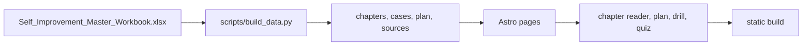

<div align="center">

# The Field Guide

**An evidence-graded field guide to being better in company.**

[](https://adineo-cmd.github.io/self-improvement-field-guide/)
   

[](https://github.com/adineo-cmd/self-improvement-field-guide/stargazers) [](https://github.com/adineo-cmd/self-improvement-field-guide/commits)

[Live site](https://adineo-cmd.github.io/self-improvement-field-guide/) · [Quick start](#quick-start) · [How it works](#how-it-works) · [Features](#features)

</div>

---

Thirteen chapters of social knowledge, built from
`Self_Improvement_Master_Workbook.xlsx`: **599 graded findings**, what the
science says, how to practise it, the myths to drop and the exact words to use.

It also includes a 12-week practice program, a weak-spot finder, drills, a quiz
and the bibliography behind every claim.

## Features

| | Feature | What it does |
| --- | --- | --- |
| 🎓 | **13 chapters** | Each entry carries an evidence-strength stamp and a source. |
| 🎯 | **Weak-spot finder** | The home page routes you to the chapter you actually need. |
| 🗣️ | **Scripts and drills** | Concrete wording and practice, not just principles. |
| 📚 | **Open bibliography** | Every source listed on one page, linked from the claim. |

## How it works

The workbook drives everything:

1. `data/Self_Improvement_Master_Workbook.xlsx` is the authored source.
2. `scripts/build_data.py` produces the chapter, case and plan JSON.
3. The parsed JSON is committed, so a plain `npm install && npm run build` works.
4. Astro renders chapters, the plan, the drill, the quiz and the source list
   from that data.



## Quick start

**Install and run**

```bash
npm install
npm run dev
```

**Production build**

```bash
npm run build
npm run preview
```

## Project structure

```text
data/                 source workbook
scripts/build_data.py workbook → JSON
src/data/             chapters, cases, elite track, plan, sources
src/pages/            home, chapters, plan, sources, drill, quiz, about
src/components/       evidence stamp, entry renderer, chrome
src/styles/           typography and layout
```

## Deployment

Every push to `main` builds the site and deploys it to GitHub Pages
through `.github/workflows/deploy.yml`:

**https://adineo-cmd.github.io/self-improvement-field-guide/**

The output is fully static — no server, no database, no runtime environment
variables.

## Regenerating the data

```bash
npm install
npm run data      # requires Python 3 with openpyxl
npm run dev
npm run check
npm run build
```

The guide is written for building yourself up and defending against
manipulation — never for tearing anyone down.
